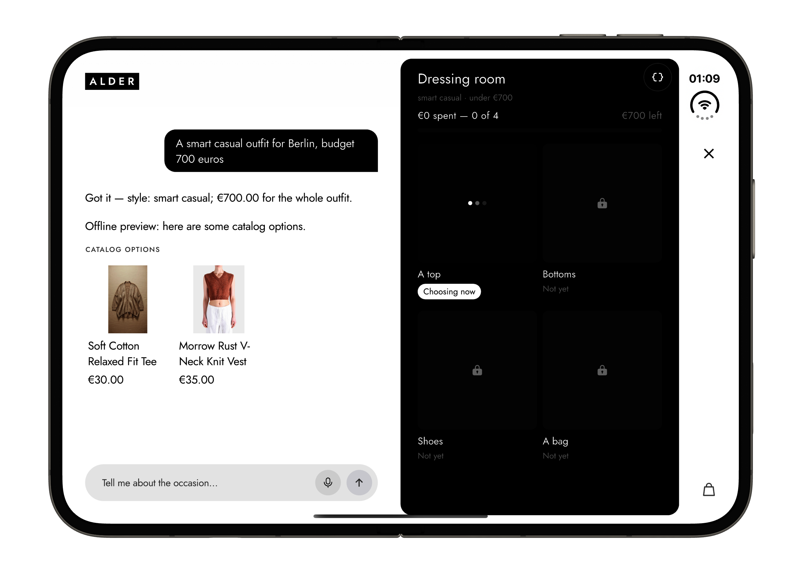
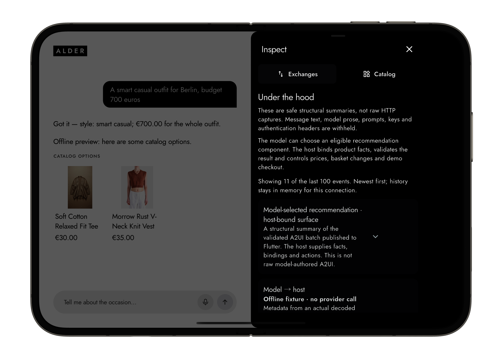
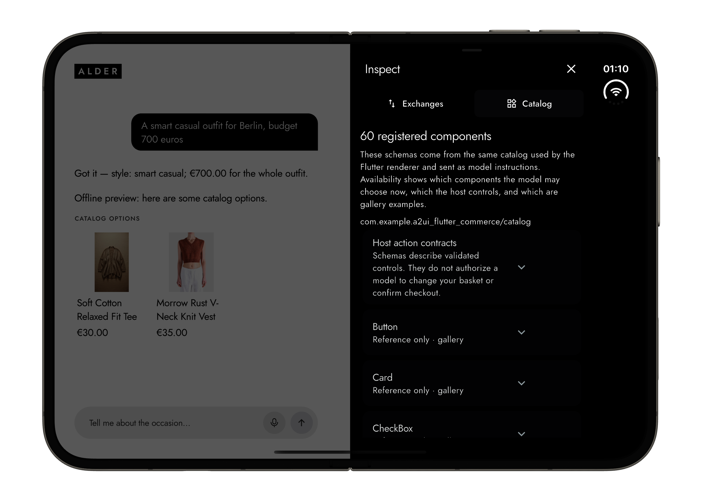

<p align="center">
  
</p>

# Alder

A personal stylist built with Flutter, Genkit Dart and A2UI. Describe an occasion, set a budget and build a look from a bundled fictional catalog. The host validates products, prices and preferences; GenUI renders the approved recommendations.

Built on the [Levin+Riegner Flutter template](docs/flutter-template.md), with BLoC presentation, repositories and constructor injection. Runs on iOS, Android and web; adapts from compact phones to the iPhone Duo showcase layout.

<p align="center">
  
  
  
</p>

## Try it

Install [Git LFS](https://git-lfs.com/) and [FVM](https://fvm.app/), then run from the checkout:

```sh
git lfs install
git lfs pull
fvm install
fvm flutter pub get
fvm flutter run -d chrome
```

Scroll down on the landing screen and choose **Explore component catalog** for a free first run with no API key. To use the stylist, choose **Connect your model** and supply a tool-capable Gemini, OpenAI, Anthropic or OpenAI-compatible model and your own API key. Connecting makes no model request; stylist interactions can incur provider charges. Keys stay in session memory. There is no application backend to deploy.

Browser connections require provider CORS support. iOS builds require an **iOS 27.1 SDK or newer**; the minimum deployment target is iOS 15.0. See [getting started](docs/getting-started.md) for platform setup and troubleshooting.

## Design resources

- [Figma design](https://www.figma.com/design/mG3g0dRExJiLZ6oWRM4CRg/Ecomm-GenUI-iPhone-Duo) — the shared design reference.
- [Editable Figma snapshot](docs/design/alder-ecommerce-genui.fig) (~56 MB, Git LFS) — an optional resource for developers exploring the screens, layouts and components. Download the file and import it into Figma to create your own editable copy. It is not required to build or run Alder.

The snapshot is a separate copy and does not stay in sync with the original. Figma exports do not include comment threads or version history; those remain in the shared Figma file. Text annotations drawn on the canvas are part of the design and remain in the snapshot.

## Read more

- [Documentation index](docs/README.md) — guides, reference and historical evidence.
- [Architecture](docs/architecture.md) and [Flutter template map](docs/flutter-template.md) — boundaries and ownership.
- [API and A2UI contracts](docs/api-reference.md) — commands, tools, surfaces and reusable widgets.
- [Genkit integration](docs/genkit-reference.md) and [developer tools](docs/developer-tools.md) — providers, tool loops, cancellation and offline inspection.
- [Using Alder](docs/experience.md), [catalog data](docs/catalog-data.md) and [demo commerce](docs/product-data-and-demo-commerce.md) — behavior and fixture limits.
- [Contributing](CONTRIBUTING.md) and [extending](docs/extending.md) — checks and implementation walkthroughs.

The catalog, prices, stock and checkout are demo data; no payment or real order is created. Code is Apache-2.0; image/font terms and outstanding public-release media reviews are recorded in [catalog and asset sources](docs/catalog-data.md) and [asset provenance](docs/asset-provenance.json).
