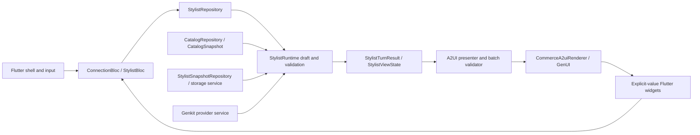

# Architecture and A2UI shape

Start with [the API and A2UI contracts](api-reference.md) for entry points, tool/action payloads and result shapes. [The documentation index](README.md) separates current guides from dated audits and verification evidence.

The [flow edge-case matrix](stylist-flow-edge-cases.md) documents restart, cancellation, stale events, category-specific sizing and recovery within this architecture.

The [product-data and demo-commerce follow-up](product-data-and-demo-commerce.md) adds evidence-bearing catalog attributes, local fictional variants/stock/size guides, fit preferences, a delivery scenario and simulated checkout receipts. These local fixtures are separate from verified merchant facts. The app remains independent of a real inventory, payment or fulfillment service.

## Architecture

The app follows the [Levin+Riegner Flutter template](flutter-template.md): feature BLoCs expose immutable presentation state, repositories coordinate data, services decode external documents, and the app root injects dependencies. The template baseline is pinned in the adherence map. This structure preserves the reference's host-authoritative commerce and A2UI contracts.

| Responsibility | Source | Contract |
| --- | --- | --- |
| Root configuration, typed routes and dependency ownership | `lib/app/`, `lib/util/dependencies.dart`, `lib/util/stylist_dependencies.dart` | An app-owned `get_it` registry composes constructor-injected dependencies; native defaults stay at this boundary. |
| Connection state and transient credential ownership | `lib/presentation/connection/` | `ConnectionBloc` exposes status/errors; `SessionConnection` owns pending connection attempts until the root accepts a session. Secrets never enter BLoC state or generated diagnostics. |
| Session events and immutable screen state | `lib/presentation/stylist/bloc/` | `CommerceSession` is a BLoC-based command/state contract; `StylistBloc` serializes commands and coordinates renderer updates. `GenkitAgent` is a compatibility constructor. |
| Connected runtime/provider lifetime | `lib/data/stylist/repository/stylist_repository.dart` | Owns one connection, cancellation and shutdown; returns typed results without exposing provider handles. |
| Catalog identity and query policy | `lib/data/catalog/model/`, `lib/data/catalog/repository/` | Complete immutable snapshot, unique IDs, EUR, explicit capabilities and shared query policy. CSV service DTOs map into validated snapshots. |
| Accepted preferences and restrictions | `lib/data/stylist/model/stylist_brief.dart`, `stylist_constraints.dart` | User facts and their provenance remain authoritative over model suggestions. |
| Weather facts and sources | `lib/data/weather/model/`, `repository/`, `service/remote/` | Typed dated facts and attribution; the repository owns freshness/cache policy and the service validates transport DTOs. |
| Monetary calculations | `lib/data/catalog/model/money.dart` | Convert public EUR values to integer cents before arithmetic. |
| Input and tool contracts | `lib/data/stylist/model/stylist_command.dart`, `stylist_schemas.dart` | Closed commands and validated payloads; shared declarative schemas govern tool and host decoding. |
| Host orchestration | `lib/data/stylist/service/runtime/stylist_runtime.dart` | Serial, bounded model/tool loop operating on a draft; no widgets, BLoCs or A2UI rendering. |
| Result and presentation intent | `lib/data/stylist/model/stylist_result.dart` | Immutable `StylistTurnResult`/`StylistViewState` without renderer/wire handles. |
| Model-facing product facts | `lib/data/stylist/model/product_facts.dart` | Authoritative catalog fields plus explicitly labelled host-derived styling heuristics. |
| Model-facing UI vocabulary | `lib/data/stylist/model/model_ui_catalog.dart`, `lib/presentation/stylist/a2ui/catalog/model_catalog.dart` | Root exports actual renderer schemas into immutable domain values; all 60 entries have guidance and availability, with four live recommendation choices. |
| Public educational inspection | `lib/data/stylist/model/commerce_trace.dart`, `lib/presentation/stylist/bloc/commerce_inspector_bloc.dart`, `lib/presentation/gallery/commerce_inspector.dart` | Independent BLoC, bounded in-memory structural history and closed safe identifiers; no prompts, prose, credentials or raw HTTP payloads. |
| Render adaptation and validation | `lib/presentation/stylist/a2ui/` | Presenter and validator prepare approved batches; `CommerceA2uiRenderer` owns live GenUI resources and rejects stale actions. |
| Pure components and layouts | `lib/presentation/shared/`, `lib/commerce_ui.dart` | Explicit values/callbacks; no transitive BLoC, GenUI, Genkit, data-adapter or gallery dependencies in the public widget entrypoint. |
| Localized fixed presentation copy | `lib/app/l10n/` | Generated English strings serve shell, connection form and shared widgets; runtime-authored notices still include English text. |
| Optional gallery tooling | `lib/presentation/gallery/`, `lib/commerce_gallery.dart` | Same widgets/bindings and replayable examples, without a provider connection. |

Screen events and immutable snapshots replace the former ChangeNotifier session. Animation, focus, scroll and native lifecycle controllers remain local widget concerns. Renderer controllers and provider credentials are owned resources, never serialized BLoC state. Starting over, retrying and closing a connection must preserve cancellation epochs and the runtime's validation-before-commit behavior.

The setup dialog collects provider settings and calls its injected `StylistConnectionFactory`. The default factory is assembled at the app root through `StylistDependencies`, loads the injected `CatalogSource` and creates an isolated runtime/provider/session. `connectStylist` is a developer convenience in the composition module. Setup makes no model request. Dismissing the setup while a connection is pending disposes its late result; the app owns each accepted session's disposal. There is no Node backend in the app.

`commerce_a2ui.dart` exports catalog registrations and schema/example serialization separately from presentation; `commerce_gallery.dart` opts into fixtures and inspection screens. [The extension walkthrough](extending.md) covers adding commands, sources and widgets. `python3 tool/check_architecture.py` enforces transitive presentation/domain import boundaries and keeps renderer/platform adapters outside the runtime. Native posture/dictation adapters remain UI concerns.

`StylistRuntime` defines the `stylistTurn` Genkit flow and catalog search, presentation, brief-saving, and outfit-editing tools. Genkit manages native conversation history and the tool loop. Search ranks local products and caps prices at the available outfit budget, accounting for pieces released by a replacement. Presentation accepts only one to five unique IDs already returned by search, and rechecks the budget, hard restrictions, and completion feasibility. The host constructs commerce A2UI surfaces from authoritative catalog facts rather than accepting model-generated card facts or arbitrary markup.

Production supplies the same catalog registrations to the renderer and, as pure exported schemas, to the model. `present_products.component` optionally selects `ProductCard`, `PicksStrip`, `ThisOrThat` or `AlternativePiece`, with count and adjustment eligibility checked before commit. Other registrations are explicitly host-controlled or gallery references. The **Inspect** sheet preserves the live renderer while exposing source-labelled model exchange summaries, host tool feedback, validation and published batch structure. See [model-ui-inspector.md](model-ui-inspector.md) for the exact scope and privacy boundary.

Search sends the model each matching product's ID, fictional name and brand,
description, category/subcategory, gender audience, color, material, season, occasion, styling
keywords, EUR price and local image path. These are structured JSON facts, not
image inputs. The photographs are inspected during offline enrichment and
rendered in the cards. Retrieval uses local word matching and filters; no
embeddings or vector service are required. The original React PoC used the same
tool-result pattern with Monostate's hybrid vector-search API, returning titles,
types, colors, tags, prices, availability and image/storefront URLs. Its adapter
did not send image pixels to the conversation model.

`StylistBrief` records the source of accepted facts. The shared budget parser recognizes explicit spending amounts without requiring a currency symbol, distinguishes item prices from outfit totals, and handles corrections. Host confirmations describe accepted facts and constraint changes separately from model styling prose. Model patches cannot replace an explicit current user value with a suggestion. Unknown form budgets remain labeled suggestions until submission; settled budgets are preserved.

`StylistBrief.gender` retains the requested product styling audience and its source. Explicit user preferences take priority over model suggestions and selection-based inference. A selected single-audience product establishes an unspecified outfit audience; search, fallback, presentation, selection, and completion estimates enforce that audience. Category alone does not establish audience: the `dress` foundation slot also contains coveralls. Removing or replacing the final single-audience anchor releases an inferred audience, while explicit preferences persist. An explicit correction retains existing incompatible pieces as visible conflicts until resolved.

Audience-qualified exclusions retain their product scope: “no men's jackets” excludes male-only jackets while keeping female/shared-audience jackets and other male product types eligible. Ordinary browsing preserves the exclusion; explicit permission or retraction releases it. The host acknowledges the audience and product type together.

`StylistConstraints` retains exact garment requests, required colors, excluded colors/materials/brands/categories, soft color/brand preferences, and already-owned categories. Hard restrictions apply to search fallback, presentation and selection. Unknown material/brand data cannot establish compliance with a corresponding restriction. Soft preference ranking runs before the result limit. Deterministic garment and color-family normalization retains the original product descriptions. Formal briefs reject explicit sleep, lounge, activewear and utility-coverall/jumpsuit evidence. These are conservative demo classifications, not fit or dress-code guarantees. The outfit plan respects settled style, skipped/owned pieces and conflicting selections. Existing pieces remain visible when new restrictions conflict, and the look cannot be reported complete until those conflicts are resolved.

QuickAdjust validates the selected ID before opening replacements. Cheaper sets a strict price ceiling below the selected item's price; another color uses a different derived color family. Both retain the selected item until an approved replacement is accepted. The host presents one replacement with AlternativePiece, exactly two comparable choices with ThisOrThat on request, and longer shortlists with PicksStrip. Preference controls use catalog color families, eligible counts and the nine actual fictional brands; bound drafts commit together on Update preferences. Owned-piece choices remove corresponding purchased selections and recalculate spend.

The host calculates a catalog-price lower bound for completing each proposed outfit. When feasible alternatives exist, recommendations preserve sufficient budget for remaining required slots. When none exists, individually affordable options remain explorable with an explicit minimum-cost or unavailable-category notice. This calculation does not establish stock, size, fit or styling compatibility.

When the retained draft cannot proceed within its budget, the host reopens BudgetSlider at the accepted amount with an explicit Update budget action. Slider movement edits only local surface data; submission updates the whole-outfit budget, preserves the selected pieces and other facts, and searches the retained next category. Recovery controls remain available when the user asks about weather during a blocked outfit.

Direct weather questions fetch the retained destination and return dated forecast facts without making a model request or advancing the outfit. Destination parsing supports explicit city phrases beyond the preset journeys. Optional trip-start/end dates are retained as validated ISO dates, editable in the preferences form. An explicit requested day/date takes priority over retained trip/weekend context; periods outside the available five-day forecast are identified as unavailable. End-only dates do not invent a start. Named-destination lookups do not request GPS. Weather side answers retain actionable approved recommendations and budget recovery controls.

`apply_outfit_changes` accepts a brief patch, explicit `clearFields`, `removeProductIds` and `addProductIds`. Combined removals and budget changes are validated against the resulting draft. All edits commit together only after the tool and full turn succeed; failed combinations preserve the prior outfit. Simple `save_outfit`, `add_to_outfit` and `remove_from_outfit` tools remain available. User-correctable `StylistInputError` messages preserve the current surfaces and leave the composer and outfit controls enabled; provider/protocol failures retain explicit retry.

Each interaction works on a draft of the conversation, seen products, outfit, budget, and turn number. Only a successful complete generation commits it. Generation is serialized per connection, limited to four provider requests and a 60-second turn deadline; the fourth generation requests prose only. Failed or cancelled turns preserve prior state and remain retryable. Starting a new look cancels pending generation, persists the reset before clearing the conversation, and retains saved looks and bag contents. Failed resets keep the previous look and controls. Committed-chat generation tokens reject native actions from a previous chat even when surface IDs are reused; cancellation epochs separately suppress late provider results.

The default catalog remains local. `CatalogSource` loads a validated `CatalogSnapshot` through the composition boundary; fixture/CSV repositories and the connected runtime share catalog query policy. The snapshot records a source revision, explicit EUR currency and stock/size/checkout capability flags. Revision is a source label, not a cryptographic fingerprint. Additional remote sources must implement this same boundary and may not invent unavailable capabilities. Gallery contracts for variants, fit, stock and checkout do not establish those services. Conversation/model history remains in memory for the current connection.

`StylistStore` is the runtime snapshot port. Production uses `StylistSnapshotRepository` to map storage DTOs to an immutable `StylistSnapshot`; `SharedPreferencesStylistService` owns serialization and platform access. `LocalStylistStore` retains a compatibility constructor. The versioned `alder.stylist.v1` value contains only current brief facts and their sources, constraints, catalog IDs, destination, up to 50 saved looks, and demo bag quantities. No provider key, conversation, forecast or image data is stored. A new connection restores state without a model request; saved products are revalidated against current catalog IDs, prices, audience, restrictions and budget before replacing the working look. Failed restoration leaves that look unchanged. Starting over clears the working look while retaining the local archive and bag.

Completed looks render actual selected pieces, optional accessories, owned-piece labels and catalog totals through Look/LookSummary. Save, restore, delete, reset, and demo bag actions are host commands and bypass the model. BagPreview and the native bag icon share authoritative quantities (1–99), cent-accurate totals, removal and guarded undo. Adding a look preserves existing quantities. The bag is explicitly a local demo: sizes, inventory and checkout receipts are deterministic local fixtures; no real stock reservation, payment, fulfillment or order is created. Product-specific colour/size/fit editors reuse inline catalog components. Shoes require a size without a clothing-fit preference; current local stock and cent-accurate affordability are revalidated before selection and simulated checkout. Local storage writes participate in turn rollback; failed or cancelled writes cannot publish a partial draft. The storage adapter is a demo convenience, not a transactional order database.

`StylistRuntime` returns a typed domain result. `presentStylistResult` constructs the host-authored A2UI batch; the shared batch validator checks component property/common schemas and surface/component/root/reference integrity before `StylistBloc` publishes it through `CommerceA2uiRenderer`, `A2uiTransportAdapter` and `SurfaceController`. The production flow does not ingest arbitrary model-authored layouts. The pinned GenUI common schema is vendored in `catalog/a2ui_common_schema.dart` with its upstream BSD license in `licenses/genui-BSD-3-Clause.txt`; review it against the pinned SDK during upgrades. `stylist_surfaces.dart` creates the persistent dressing-room surface and a new inline recommendation surface per successful turn. Submitted messages and committed inline surfaces form an ordered conversation history. Previous recommendations remain readable, with pointer, keyboard and assistive actions disabled. The transport also rejects actions from obsolete inline surfaces.

Progressive rendering uses a separate, temporary inline surface. It starts with an explicit loading state and streams prose only from the final tool-free model request through a per-turn callback outside serialized flow inputs. Complete sentences pass the same financial-prose filter used for the final reply; the host supplies accepted facts and amounts. Tool-stage prose and product cards stay hidden until the full turn validates. Provisional text carries no actions and does not update the committed dressing room or outfit. Success replaces the temporary text with the committed response without replaying its text animation, then queues the remaining sections below it; failure, cancellation or disconnect removes it. Retries reuse the original conversation entry.

`genkit_providers.dart` configures the official Gemini, OpenAI, Anthropic, and OpenAI-compatible plugins. OpenAI uses Chat Completions with `store: false`. Real keys enter HTTP headers at the transport boundary; plugin configurations contain a placeholder. The transport validates destinations, refuses redirects, sanitizes provider failures before SDK errors/traces, and bounds provider requests. A Dart Zone carries mutable per-turn draft state outside serialized flow context. Disconnect clears the key, cancels outstanding work, disposes the owned HTTP client and Genkit runtime, and discards the session.

The same flow runs in the optional Genkit Developer UI through `tools/genkit/stylist.dart`, using a free offline model. The connected Flutter runtime disables reflection and automatic telemetry. The optional Genkit CLI is a development dependency only. Genkit Dart, its provider plugins, and Schemantic are pinned to 1.0.0. Provider models are resolved through the public `GenkitPlugin.model` API and invoked with the turn cancellation token. OpenAI and Anthropic accept an injected HTTP client; Google uses the documented `http.runWithClient` factory scoped to each invocation. There are no private package imports. See [genkit-reference.md](genkit-reference.md) for the integration contract, upgrade guidance, and regression coverage.

The Flutter app runs natively and builds for web. Direct browser requests depend on provider CORS support; native apps do not require CORS. Keys must not appear in assets, source, generated bundles, saved browser state, or committed environment files.

## A2UI shape

The catalog includes the basic GenUI catalog plus a small extensible commerce vocabulary:

- `StylistMessage`
- `Eyebrow`
- `ProductCard`
- `ChoiceChip`
- `ChoiceGroup`
- `PrimaryButton`
- `PieceSlot`
- `DressingRoom`
- `BudgetSlider`

The flow is `brief → picks → complete look`. The dressing room is created once and updated through its data model. Recommendation surfaces can be replaced on each turn. This keeps the host-owned responsive shell stable while allowing the agent-generated content to evolve.

`OutfitPlan` derives the required pieces from the brief and selected foundation, following the original React PoC: formal looks default to an eligible one-piece when the catalog supports it, ordinary looks use separates, and outdoor looks start with a layer and footwear. Formal requests without a compatible one-piece use separates; explicit garment and selected/owned foundation choices remain authoritative. Cold-weather looks include a layer. Selecting a dress releases any selected top and bottom; selecting separates releases the dress before checking the resulting budget. Accessories are optional and selected pieces remain visible even when outside the required route.

`StylistBrief` retains occasion, dress code, season, budget, palette, and notes outside model history. Preset journeys supply their known facts. Searching requires a dress code and budget; a host-owned form gathers missing facts together, and its editors update local surface data until one explicit Find options action submits them. The model can use `save_outfit` for typed refinements, `add_to_outfit` for a verbal choice from the last presented cards, and `remove_from_outfit` for a selected product. These tools mutate only the current draft and return the refreshed host plan and budget facts.

The runtime supplies the model with the recorded outfit and the next missing category. A successful selection immediately offers that next category; removing a piece reopens its category. Once all required pieces are selected, the stylist summarizes the completed look and offers to keep or change it. The dressing-room slot list and its current-choice marker come from the same host plan. Host-calculated selection confirmations and budget amounts remain authoritative without replacing the stylist's explanation.

Regression coverage follows every bundled journey through completion and reopens a removed piece, using the real local catalog with a deterministic test model. Widget tests exercise selection buttons, dressing-room slots, and product photographs. Shared wire fixtures under `test/fixtures/protocol/` exercise the real GenUI renderer, including bound properties, data-only updates, loading states, and structured actions. Conversation and progressive-rendering tests cover inactive history, preview cleanup, rollback and retry. The opt-in live test checks that Berlin starts with tops, selecting one presents bottoms, and removing it presents tops again, within three interactions and twelve provider requests. Its optional seeded-preview mode checks only the real selection continuation; network checks run separately from widget rendering.

The protocol boundary is intentionally explicit:

1. The agent emits a `CreateSurfaceMessage` with the catalog ID.
2. The agent emits `UpdateComponentsMessage` entries whose component properties bind to data paths.
3. The agent emits `UpdateDataModelMessage` values for the surface.
4. The Flutter `Surface` resolves the catalog item and renders the registered builder.
5. User actions become structured `UserActionEvent` values and are dispatched back through the transport boundary.

Conversation replies omit utility entry points for preferences, product details/sizes, comparison, saved looks and the bag. The app omits the host overflow menus; the dressing-room close and bag controls remain available, and historical replies never expose auxiliary actions. The start and conversation composers share the Figma dock: a 52-point pill, 32-point inner-display gutters and bottom clearance, and a 24-point fade into an opaque backing. The input fills its column without sampling scrolling cards through a glass blur. Keyboard insets and bottom cutouts still constrain the pane.

Hinge geometry changes on the same inner display ease between pane bounds over 320 ms. The keyed panes preserve draft, focus and scroll state, and a new hinge event retargets the current animation. Display changes, rotation, keyboard changes and Reduce Motion apply geometry immediately.

The persistent `dressing-room` surface owns the evolving look. Inline surfaces are versioned per turn (`inline-0`, `inline-1`, and so on) so recommendations can be replaced without losing the persistent surface state.

See [component-catalog.md](component-catalog.md) and [component-library-audit.md](component-library-audit.md) for the registered vocabulary and extension path. The audit preserves its original baseline; [component-adoption-progress.md](component-adoption-progress.md) records subsequent local integration.

Explicit item choices publish an immutable, renderer-independent outfit preview after local validation. The GenUI adapter presents it immediately and restores the previous room and recommendation emphasis if the turn fails. Size forms collapse during save and return on failure; weather context is shown only at intake, on destination changes, on resume or for explicit weather questions.

Selection replies combine the item, host budget and sizing instruction once. Saving size/fit introduces the actual next category. Unchosen recommendations fade, while the selected choice remains visible. Restart requires confirmation and transitions fade between views, respecting Reduce Motion. Bag dialogs scroll the item list while retaining actions, falling back to full-content scrolling in short or large-text layouts. Catalog scrolling extends through ambient bottom padding, retaining hardware and keyboard bounds.
