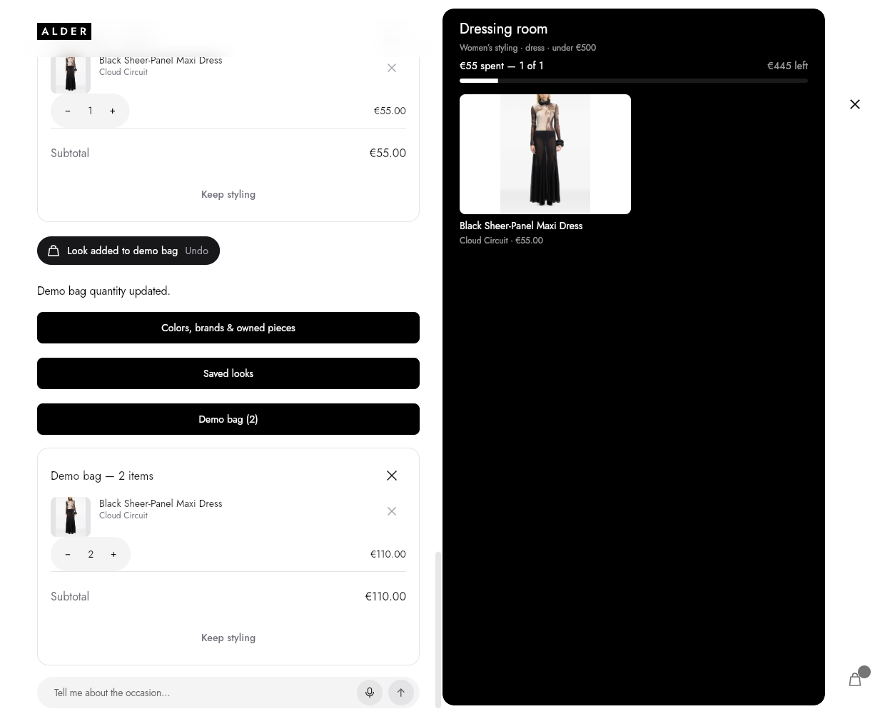
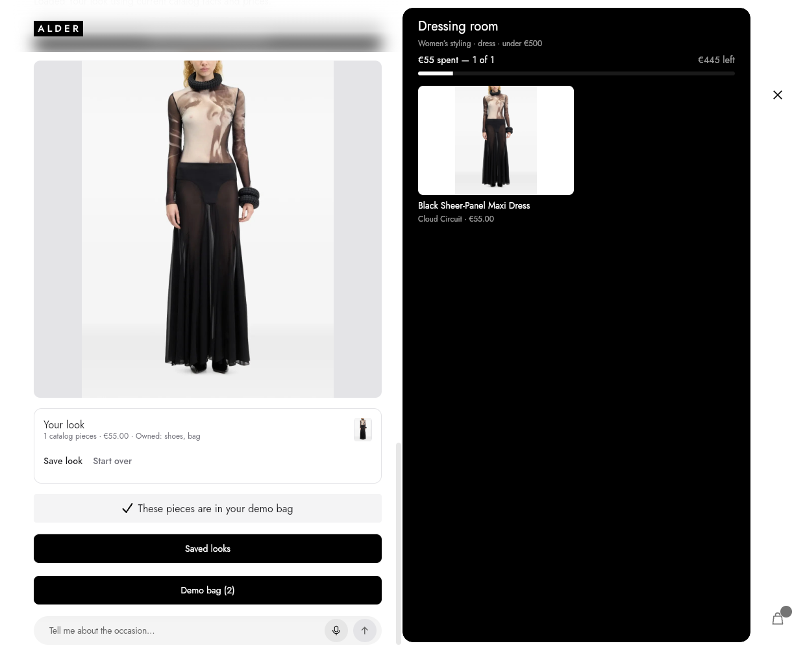
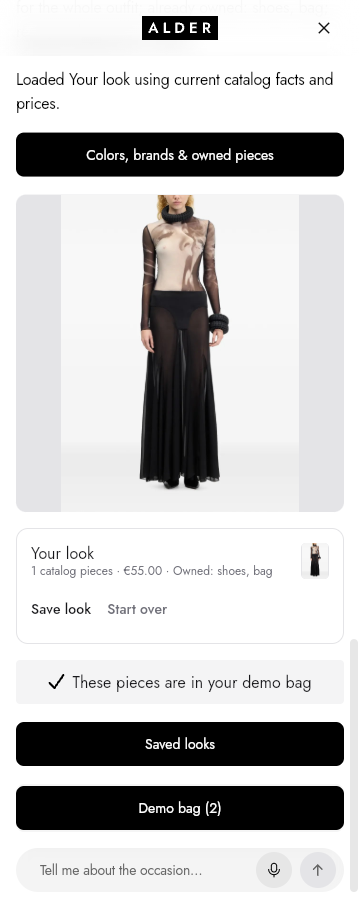

# Component adoption verification — 15 October 2026

Local feature-branch verification; no provider calls, Git publication or simulator installation.

- 493 Flutter tests passed, including actual rendered comparison, preference, replacement, library and bag interactions. A rejected storage write preserves the displayed quantity and host state.
- Flutter analysis clean; formatting/source diff checks passed; 31 Python tests passed; catalog validator passed.
- Final normal web and iOS simulator builds passed. [Bundle proof](bundle-proof.json) checks the source CSV bytes and every product photo in both outputs.
- [Browser proof](browser-proof.json): the real app with its full catalog, deterministic offline model and actual SharedPreferences web plugin. Real pointer interactions saved the selected dress, added it to the demo bag, increased quantity to two, reloaded the Flutter engine, reset the working look and restored its saved state. The accepted €500 budget, female audience and exact catalog ID survived. No JavaScript errors or live-provider requests.
- The harness blocked all external requests. The existing schema validator attempted 82 metadata fetches from `https://json-schema.org/draft/2020-12/schema`; the flow succeeded with them blocked. This is not a claim that the normal app makes zero external request attempts.
- Screenshots were inspected at 1240×1000 and 360×900. Widget/gallery tests additionally cover narrow panes and large text. These are browser and local build results, not live-provider or running-Duo evidence.

