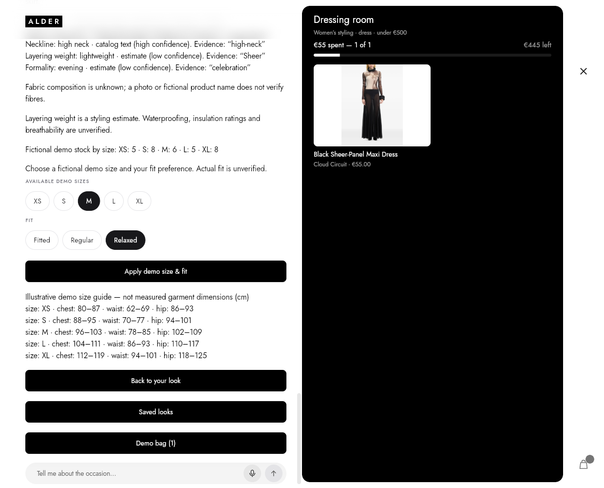
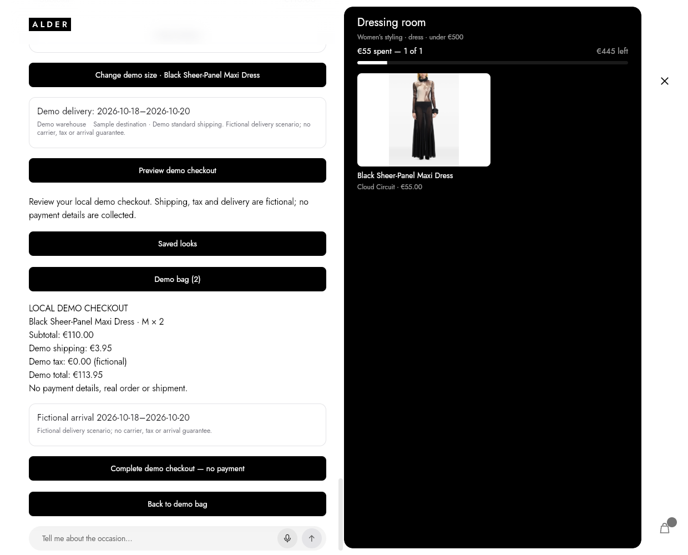
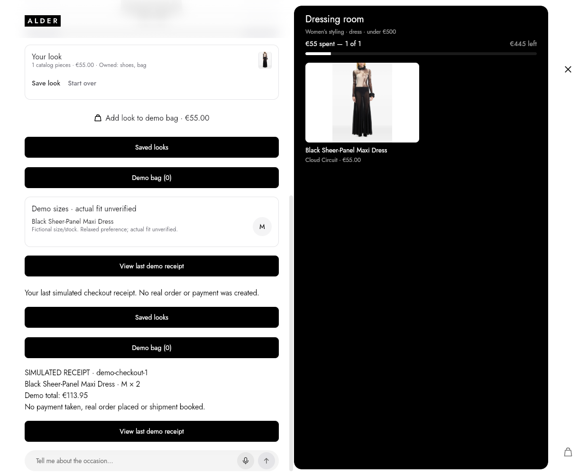
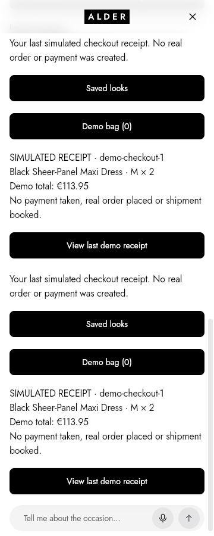

# Product data and demo-commerce verification

Historical evidence captured before the architecture port in this PR. These browser screenshots and native build results do not verify the ported worktree; see [the flow review](../../stylist-flow-edge-cases.md#pr-review-follow-up) for its checks.

15 October 2026, local working-tree increment. The shared checkout advanced to `main` at `81a6132` (PR #19) during the work; the product-data/demo-commerce increment remains uncommitted. This work made no Git publication, simulator installation, merchant connection or payment. Verification was repeated against the updated base.

- Full Flutter suite: **501 tests passed**. Final focused product-data/commerce suite: **7 tests passed**, including the rendered size-guide unit wording, separate clothing/footwear preferences and actual checkout controls.
- Flutter analyzer clean; 92 Dart files passed formatting; source diff whitespace checks passed.
- Final normal web and iOS simulator builds passed. [Catalog/bundle proof](catalog-and-bundle-proof.json) verifies the exact CSV and 977 photos. CSV and every photo are byte-identical to the prior component-adoption checkpoint.
- [Enrichment summary](enrichment-summary.json): all 977 products classified, with exact per-field evidence/confidence and explicit unknowns. The reproducible full report is `.catalog-work/product-data-20261015/enrichment.json`; run `dart run tool/export_product_data.dart <output-path>` to recreate it. Runtime parsing uses the same rules.
- [Browser proof](browser-proof.json): the actual Flutter app, full catalog, deterministic offline model and production SharedPreferences web plugin. Real pointer interactions selected a dress, chose M/Relaxed, added two units, reviewed delivery/checkout, completed a simulation and reopened its receipt after a full reload. The €500 budget and female styling preference were retained. Demo stock consumed two units; the bag cleared; the receipt total was €113.95 (including €3.95 demo shipping).
- No JavaScript errors or model-provider requests. The harness blocked all external traffic, including 123 JSON-schema metadata and 11 fallback-font requests. Their presence is recorded rather than described as zero external request attempts. Screenshots were inspected at desktop 1240×1000 and phone 360×900.
- The web build retains its existing optional CupertinoIcons font warning. This evidence establishes local builds and browser behavior, not live-provider or running-Duo behavior.

